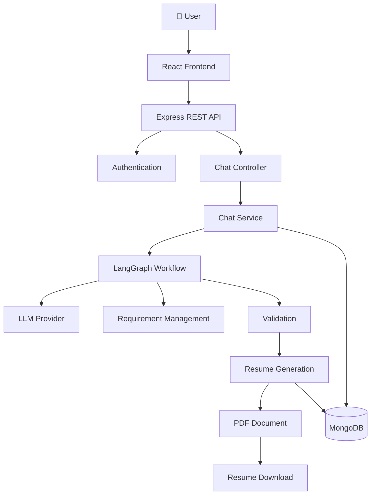
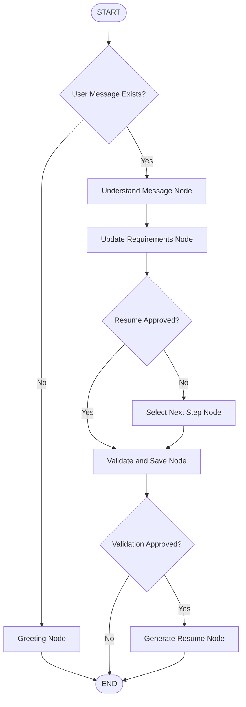
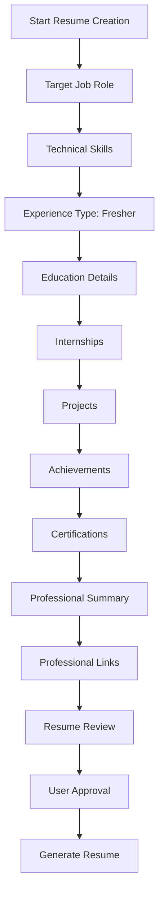
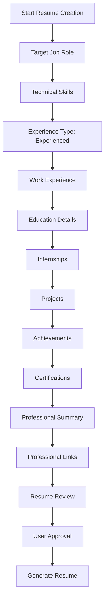
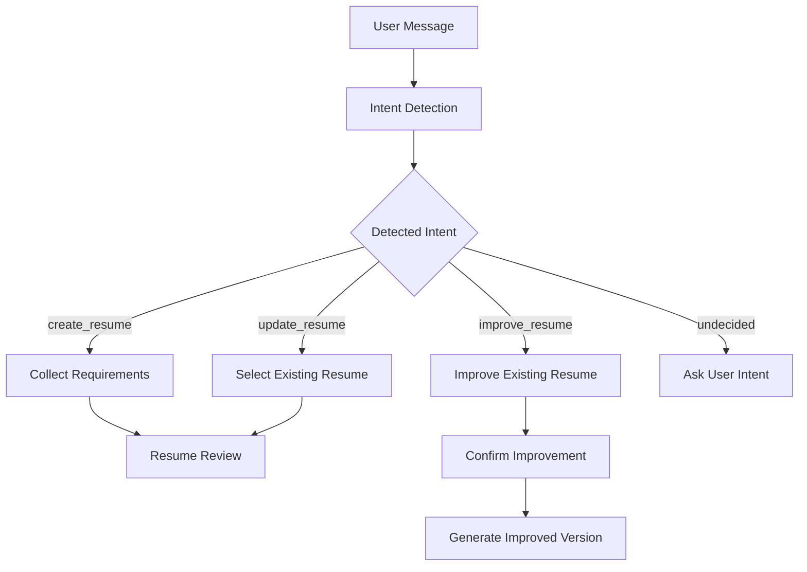
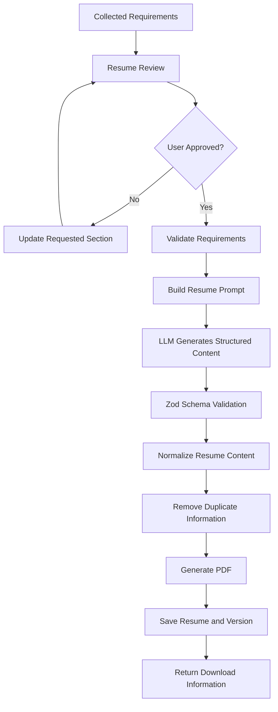

<div align="center">

# 🤖 AI Resume Builder

### Build professional resumes by simply *talking* to an AI agent.

An AI-powered, conversational resume builder that collects your details step by step, validates them, and generates a structured, professional resume.

<br/>


<br/>

[Features](#-key-features) •
[Architecture](#-system-architecture) •
[AI Workflow](#-ai-agent-workflow) •
[Setup](#-installation--setup) •
[API](#-api-reference) •
[Roadmap](#-roadmap)

</div>

---

## 📖 Table of Contents

- [Overview](#-overview)
- [Key Features](#-key-features)
- [Tech Stack](#-tech-stack)
- [System Architecture](#-system-architecture)
- [AI Agent Workflow](#-ai-agent-workflow)
- [Conversation Flow](#-conversation-flow)
- [Intent Detection](#-intent-detection)
- [Requirement Collection](#-requirement-collection)
- [Resume Generation Pipeline](#-resume-generation-pipeline)
- [Database Design](#-database-design)
- [Project Structure](#-project-structure)
- [API Reference](#-api-reference)
- [Installation & Setup](#-installation--setup)
- [Environment Variables](#-environment-variables)
- [Screenshots](#-screenshots)
- [Roadmap](#-roadmap)
- [Security](#-security-considerations)
- [Contributing](#-contributing)
- [License](#-license)
- [Author](#-author)

---

## 🚀 Overview

Instead of filling out a long, boring resume form, users chat with an AI assistant. The agent does **not** generate a resume from a single message — it follows a structured, stateful workflow:

1. 🎯 Understands the user's intent (create / update / improve).
2. 📥 Collects personal and professional information.
3. 🧑‍💼 Detects whether the candidate is a **fresher** or **experienced**.
4. ❓ Asks questions dynamically based on experience type.
5. ✅ Validates the collected information.
6. 👀 Shows a complete resume preview for approval.
7. 📄 Generates and saves the final resume.

> **🎯 Goal:** a personalized, guided and structured resume-creation experience powered by **LangChain + LangGraph**.

---

## ✨ Key Features

<table>
<tr>
<td width="50%" valign="top">

### 💬 Conversational Interface
- Chatbot-based resume creation
- Natural language understanding
- Dynamic question generation
- Context-aware conversations
- Step-by-step information collection

### 🛠 Multiple Resume Operations
- Create a new resume
- Update an existing resume
- Improve an existing resume
- Generate a new improved version

### 🧑‍🎓 Fresher & Experienced Support
- Workflow adapts to the candidate type
- Different question order for each type

</td>
<td width="50%" valign="top">

### ✅ Validation & Approval
- Validates collected information
- Maintains structured requirements
- Lets users review before generation
- Generates the resume only after approval

### 📄 Resume Generation
- Structured resume content
- PDF generation
- Resume version management
- Download support
- Single-page resume option

### 🗂 Session Management
- Persistent chat sessions
- Stored conversation messages
- Chat history retrieval
- Workflow state kept across turns

</td>
</tr>
</table>

### 📋 Information the Agent Collects

`Target Role` · `Skills` · `Experience Type` · `Work Experience` · `Education` · `Internships` · `Projects` · `Achievements` · `Certifications` · `Professional Summary` · `GitHub / LinkedIn / Portfolio links`

---

## 🛠 Tech Stack

| Layer | Technology | Purpose |
|-------|-----------|---------|
| 🎨 Frontend | **React.js** | User interface |
| ⚙️ Runtime | **Node.js** | Backend runtime |
| 🌐 API | **Express.js** | REST API development |
| 🗄 Database | **MongoDB + Mongoose** | Data storage & modeling |
| 🔐 Auth | **Firebase Authentication** | User authentication |
| 🧠 AI Framework | **LangChain** | LLM integration & message handling |
| 🔀 Orchestration | **LangGraph** | Stateful AI workflow |
| ✔️ Validation | **Zod** | Structured data validation |
| ⚡ LLM | **Groq** | AI model inference |
| 📄 PDF | PDF generation library | Resume PDF output |

---

## 🏗 System Architecture



| Component | Responsibilities |
|-----------|------------------|
| **Frontend** | Chat interface, resume preview, resume download, session history |
| **Backend** | API management, authentication, session management, database operations, AI workflow execution |
| **AI Workflow** | Intent detection, information extraction, requirement management, dynamic question selection, validation, resume generation |
| **Database** | Users, chat sessions, chat messages, resumes and versions |

---

## 🤖 AI Agent Workflow

The heart of the project is a **LangGraph-based stateful workflow**. Every message is processed in the context of the current session state instead of independently.



### 🧩 Workflow Nodes

| # | Node | What it does |
|---|------|--------------|
| 1 | 👋 **Greeting** | Welcomes the user and asks what they want to do |
| 2 | 🧠 **Understand Message** | Detects intent, extracts resume data, section actions, format preferences and approval requests |
| 3 | 🔄 **Update Requirements** | Updates the structured requirements using the extracted information |
| 4 | ➡️ **Select Next Step** | Picks the next question based on step, experience type, missing data, status, requested section and intent |
| 5 | 🛡 **Validate and Save** | Validates the data and handles approval before generation |
| 6 | 📄 **Generate Resume** | Generates the resume from confirmed data and stores it |

<details>
<summary><b>📦 Example requirement object</b></summary>

```js
{
  experienceType: {
    status: "answered",
    value: "experienced",
    updatedAt: "2026-10-30T10:00:00.000Z"
  }
}
```

</details>

---

## 🔄 Conversation Flow

The question order differs for freshers and experienced candidates. Experienced candidates share their work history **before** education.

<details open>
<summary><b>🧑‍🎓 Fresher Flow</b></summary>



</details>

<details open>
<summary><b>💼 Experienced Candidate Flow</b></summary>



</details>

---

## 🎯 Intent Detection

| Intent | Description |
|--------|-------------|
| `undecided` | User intent is not yet identified |
| `create_resume` | Create a new resume |
| `update_resume` | Update an existing resume |
| `improve_resume` | Improve an existing resume |



---

## 📋 Requirement Collection

| Section | Information Collected |
|---------|----------------------|
| 🎯 Target Role | Desired job title |
| 🧰 Skills | Technical and professional skills |
| 🧑‍💼 Experience Type | Fresher or experienced |
| 💼 Work Experience | Company, designation, dates, responsibilities |
| 🎓 Education | Degree, institution, graduation year, field of study |
| 🏢 Internships | Organization, designation, duration, responsibilities |
| 🚀 Projects | Name, technologies, role, description, URLs |
| 🏆 Achievements | Awards and accomplishments |
| 📜 Certifications | Name, issuer, date, credential URL |
| 📝 Professional Summary | Manually provided or AI-generated |
| 🔗 Links | GitHub, LinkedIn, portfolio, LeetCode |

### 🚦 Requirement Status Management

Each requirement carries a status so the workflow always knows what is collected and what is still missing.

```js
export const REQUIREMENT_STATUS = {
    PENDING: "pending",
    IN_PROGRESS: "in_progress",
    ANSWERED: "answered",
    COMPLETED: "completed",
    CONFIRMED: "confirmed",
    NOT_APPLICABLE: "not_applicable",
};
```

---

## 📄 Resume Generation Pipeline



### 🧭 Generation Principles

- ✅ Use **only confirmed** information from the current requirements
- 🚫 Never invent work experience, education, achievements or skills
- 🔁 Avoid duplicate sections and repeated information
- 🛡 Validate generated content against the expected Zod schema
- 🧾 Preserve the user's actual information
- 📦 Generate the requested output format

---

## 🗄 Database Design

MongoDB with Mongoose. *This is a conceptual design — adapt it to the actual schemas.*

<details>
<summary><b>👤 Users</b></summary>

```js
{
  _id: ObjectId,
  firebaseUid: String,
  name: String,
  email: String,
  createdAt: Date,
  updatedAt: Date
}
```

</details>

<details>
<summary><b>💬 Chat Sessions</b></summary>

```js
{
  _id: ObjectId,
  userId: ObjectId,
  intent: String,
  currentStep: String,
  pendingQuestion: String,
  requirements: Object,
  approvalStatus: String,
  createdAt: Date,
  updatedAt: Date
}
```

</details>

<details>
<summary><b>✉️ Chat Messages</b></summary>

```js
{
  _id: ObjectId,
  sessionId: ObjectId,
  role: String,
  content: String,
  createdAt: Date
}
```

</details>

<details>
<summary><b>📄 Resumes</b></summary>

```js
{
  _id: ObjectId,
  userId: ObjectId,
  sessionId: ObjectId,
  title: String,
  fileName: String,
  downloadUrl: String,
  format: String,
  createdAt: Date,
  updatedAt: Date
}
```

</details>

<details>
<summary><b>🕘 Resume Versions</b></summary>

```js
{
  _id: ObjectId,
  resumeId: ObjectId,
  versionNumber: Number,
  content: Object,
  fileName: String,
  downloadUrl: String,
  createdAt: Date
}
```

</details>

---

## 📁 Project Structure

```bash
backend/
├── src/
│   ├── config/
│   │   ├── database.js
│   │   └── firebase.js
│   ├── modules/
│   │   ├── auth/
│   │   ├── chat/
│   │   └── resume/
│   ├── aiWorkflow/
│   │   ├── constants/
│   │   │   └── workflow.constants.js
│   │   ├── workflow/
│   │   │   ├── workflow.graph.js
│   │   │   └── workflow.state.js
│   │   ├── understand-message.js
│   │   ├── update-requirements.js
│   │   ├── select-next-step.js
│   │   ├── validate-and-save.js
│   │   └── generate-resume.js
│   ├── middleware/
│   ├── utils/
│   ├── app.js
│   └── server.js
├── .env
├── .env.example
└── package.json
```

---

## 🔌 API Reference

| Method | Endpoint | Description |
|:------:|----------|-------------|
| `POST` | `/api/auth/...` | Authentication |
| `POST` | `/api/chat/sessions` | Create a chat session |
| `GET` | `/api/chat/sessions` | Get all chat sessions |
| `GET` | `/api/chat/sessions/:sessionId/messages` | Get messages of a session |
| `POST` | `/api/chat/sessions/:sessionId/messages` | Send a chat message |
| `GET` | `/api/resumes` | Get user resumes |
| `GET` | `/api/resumes/:resumeId` | Get resume details |
| `GET` | `/api/resumes/:resumeId/download` | Download a resume |

---

## ⚙️ Installation & Setup

### Prerequisites

- [Node.js](https://nodejs.org/) & npm
- [MongoDB](https://www.mongodb.com/) (local or Atlas)
- A [Firebase](https://firebase.google.com/) project
- A [Groq](https://console.groq.com/) API key

### 1️⃣ Clone the repository

```bash
git clone https://github.com/ganeshk6/ai-resume-builder-agent.git
cd ai-resume-builder-agent
```

### 2️⃣ Setup the backend

```bash
cd backend
npm install
```

Create a `.env` file in the `backend` directory (see [Environment Variables](#-environment-variables)), then start the server:

```bash
npm run dev
```

### 3️⃣ Setup the frontend

Open a new terminal:

```bash
cd frontend
npm install
npm run dev
```

Open the URL shown in your terminal (usually `http://localhost:5173`). 🎉

---

## 🔐 Environment Variables

```env
PORT=3001
MONGODB_URI=your_mongodb_connection_string
FRONTEND_URL=http://localhost:5173
FIREBASE_PROJECT_ID=your_firebase_project_id
GROQ_API_KEY=your_groq_api_key
GROQ_MODEL=your_configured_model
```

| Variable | Description |
|----------|-------------|
| `PORT` | Backend server port |
| `MONGODB_URI` | MongoDB connection string |
| `FRONTEND_URL` | Frontend application URL |
| `FIREBASE_PROJECT_ID` | Firebase project identifier |
| `GROQ_API_KEY` | LLM provider API key |
| `GROQ_MODEL` | Configured LLM model |

> [!WARNING]
> Never commit `.env`, Firebase private credentials, API keys or database credentials to GitHub.

---

## 🖼 Screenshots

> Add your screenshots to `docs/screenshots/` and they will show up here automatically.

| Home | Login |
|:----:|:-----:|
|  |  |

| Chat Interface | Experience Details |
|:--------------:|:------------------:|
|  |  |

| Education Details | Resume Review |
|:-----------------:|:-------------:|
|  |  |

| Generated Resume |
|:----------------:|
|  |

---

## 🗺 Roadmap

- [ ] Multiple professional resume templates
- [ ] DOCX export support
- [ ] ATS compatibility analysis
- [ ] Resume scoring and recommendations
- [ ] Job-description-based resume customization
- [ ] AI-powered cover letter generation
- [ ] LinkedIn profile integration
- [ ] Resume analytics and version comparison
- [ ] Advanced resume editing tools
- [ ] Deployment with Docker and CI/CD

---

## 🔒 Security Considerations

- Protect API routes with authentication middleware
- Validate all incoming requests
- Keep API keys in environment variables
- Apply ownership checks before accessing resumes and sessions
- Avoid exposing sensitive user information
- Sanitize and validate generated file operations

---

## 🤝 Contributing

Contributions, feature suggestions and bug reports are welcome!

1. 🍴 Fork the repository
2. 🌿 Create a feature branch (`git checkout -b feature/amazing-feature`)
3. 💾 Commit your changes (`git commit -m "Add amazing feature"`)
4. 📤 Push the branch (`git push origin feature/amazing-feature`)
5. 🔁 Open a Pull Request

---

## 📜 License

Distributed under the **MIT License**. Add a `LICENSE` file to the repository before publishing.

---

## 👨‍💻 Author

<div align="center">

**Ganesh Kumar**

[](https://github.com/ganeshk6)
[](https://www.linkedin.com/in/ganesh-kumar-47988621b/)

<br/>

⭐ **If you find this project useful, consider giving it a star!** ⭐

</div>